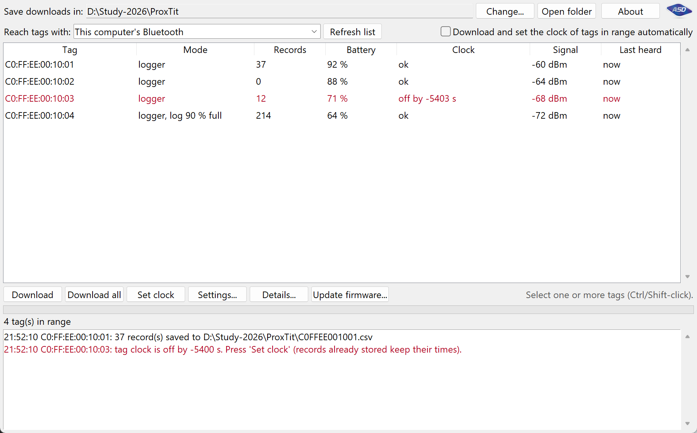

# proxtool — ProxTit Tags

**proxtool** is the open-source PC software (Windows, Linux¹) for ASD's
[ProxTit](https://asd-tech.com) Bluetooth proximity loggers. Its window,
**ProxTit Tags**, and its command line let you:

- **Find tags in range** and see their records waiting, battery, clock and signal.
- **Download** the encounter logs to one CSV file per tag. A record leaves a tag
  only after it is saved on the computer.
- **Set the clocks** of one tag or many at once (UTC).
- **Change the settings** (proximity threshold, silence time, maximum encounter
  length, TX power, beacon and scan timing) and give a whole study identical
  settings.
- **Update the tag firmware** over Bluetooth.
- **Collect unattended**: download and set the clock of every tag that comes in
  range, for as long as the computer runs.

Tags are reached with the computer's own Bluetooth or with a **USB Bluetooth
adapter** (a Silicon Labs Thunderboard with NCP firmware), which can sit next to
the animals on a USB extension.

*The ProxTit Tags window with four tags in range (made-up example). The tag in red
restarted after a power cut and its clock needs setting.*

This documentation is not a substitute for the ProxTit user guides and datasheets,
which are on the ASD website. *It is a work in progress: if something is missing
or unclear, please [open an issue](https://github.com/ASD-Alexander-Schwartz-Developments/proxtool/issues).*

## Where to start

| I want to… | Read |
|---|---|
| Install proxtool | [Getting Started](Getting-Started) |
| Choose between the computer's Bluetooth and a USB adapter | [Reaching Tags](Reaching-Tags) |
| Get the data off the tags | [Downloading Data](Downloading-Data) |
| Leave a computer collecting by itself | [Automatic Collection](Automatic-Collection) |
| Set the tag clocks | [Clock](Clock) |
| Change tag settings, choose a silence time for my species | [Tag Settings](Tag-Settings) |
| Update the tag firmware | [Firmware Updates](Firmware-Updates) |
| Use tags that still run firmware 01.02.x | [Older Firmware](Older-Firmware) |
| Script it | [Command Line](Command-Line) |
| Set up Linux | [Linux Setup](Linux-Setup) |
| Fix a problem | [Troubleshooting and FAQ](Troubleshooting-and-FAQ) |
| Build on it, or add a radio | [For Developers](For-Developers) |

## About proxtool

proxtool is open source under the Apache License 2.0
([repository](https://github.com/ASD-Alexander-Schwartz-Developments/proxtool)).
The tag protocol it speaks is public too: [docs/ble-protocol.md](https://github.com/ASD-Alexander-Schwartz-Developments/proxtool/blob/main/docs/ble-protocol.md).
The ASD name and logo are trademarks of A.S.D and are not covered by the licence.
Components from others: [Third-Party Licenses](Third-Party-Licenses).

¹ Windows 10/11 is tested. Linux is supported by design and not yet verified on
hardware. macOS is not supported: it hides Bluetooth addresses, which proxtool
uses to tell tags apart.
