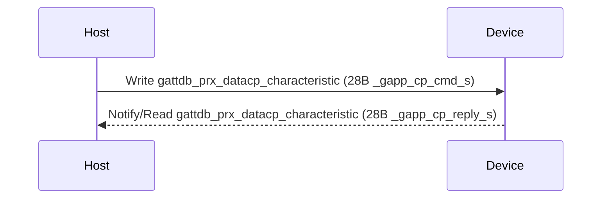

> **Archived page (January 2026)** describing the protocol of tag firmware **01.02.x**, as used by the
> earlier proxtit-downloader-py scripts. Kept unchanged for reference. The current protocol (firmware
> 02.00 and later, plus the differences to 01.02.x) is in
> [docs/ble-protocol.md](https://github.com/ASD-Alexander-Schwartz-Developments/proxtool/blob/main/docs/ble-protocol.md);
> see also [Older Firmware](Older-Firmware).

# PRX (Proxtit) – Communication Protocol

Proxtit tags implement BLE protocol with several services and chanracteristics:

1. Device Information Service (0x180A) - GATT Standard service presents readonly characteristics describing the tag
    a. Manufacturer Name String (0x2A29)
    b. Model Number String (0x2A24)
    c. Hardware Revision String (0x2A27)
    d. Firmware Revision String (0x2A26)
    e. SystemID (0x2A23)
    f. Serial Number String (0x2A25)

2. PRX Service (Custom) (01e59576-be13-47da-9c29-354a565cc874)
    a. prx_datacp_characteristic (8093f8a5-82ce-4fac-9fb3-f7dab64c0b74) - Read/Write fixed length (28 Bytes) data packets to control/configure tag
    b. prx_log_characteristic (1d316924-9f39-47a3-a16d-a39846473eac) - Read only fixed length characteristic to download logged data from the tag


## PRX Data Control Point Characteristic (prx_datacp_characteristic )


**Message Types:** `_gapp_cp_cmd_s` (Command), `_gapp_cp_reply_s` (Reply)

**Transport:** Bluetooth LE GATT characteristic (`gattdb_prx_datacp_characteristic`). The host writes a command; the device responds by updating/notifying the characteristic with a reply.

**Packing & Size:** Both wire structs are `__attribute__((packed))` and contain a 1‑byte opcode plus a 27‑byte parameter area → **28 bytes total**.

---

## 1) Wire Format

### 1.1 Command (`_gapp_cp_cmd_s`)

```c
#define GAPP_CP_REPLY_MAXPARAMS 27

struct _gapp_cp_cmd_s {
    uint8_t cmd;                         // opcode
    uint8_t data[GAPP_CP_REPLY_MAXPARAMS]; // parameters
} __attribute__((__packed__));
```

**Layout (byte offsets):**

| Offset | Size | Field | Meaning |
|:------:|:----:|:------|:--------|
| 0 | 1 | `cmd` | Command ID (see §3) |
| 1–27 | 27 | `data[]` | Command parameters (command‑specific). Multi‑byte integers are little‑endian. |

---

### 1.2 Reply (`_gapp_cp_reply_s`)

```c
struct _gapp_cp_reply_s {
    uint8_t rcmd;                        // reply code
    uint8_t data[GAPP_CP_REPLY_MAXPARAMS]; // result payload
} __attribute__((__packed__));
```

**Layout (byte offsets):**

| Offset | Size | Field | Meaning |
|:------:|:----:|:------|:--------|
| 0 | 1 | `rcmd` | Reply code: `CMD | 0x80` (success) or `CMD` (failure) |
| 1–27 | 27 | `data[]` | Reply payload (command‑specific). Multi‑byte integers are little‑endian. |

**Firmware debug markers:**
- The device often stamps `data[10] = 0x56` and `data[13] = 0x55` in replies. These can be ignored unless your host explicitly checks them.

---

## 2) Transport & Framing (BLE GATT)

- The reply buffer is written at boot to the GATT database under `gattdb_prx_datacp_characteristic` and updated upon command processing.
- Commands are delivered as a 28‑byte write of `_gapp_cp_cmd_s`. The device publishes a 28‑byte `_gapp_cp_reply_s` via characteristic update/notification.



---

## 3) Command IDs


| ID (hex) | Macro | Implemented in `app.c`? |
|:--------:|:------|:------------------------|
| 0x01 | `GAPP_CMD_GETNFILES` | Not handled |
| 0x02 | `GAPP_CMD_FINDFILE` | Not handled |
| 0x03 | `GAPP_CMD_UPDATERECIPE` | Not handled |
| 0x04 | `GAPP_CMD_UPDATERCOMMIT` | Not handled |
| 0x06 | `GAPP_CMD_STOPDNLD` | Not handled |
| 0x07 | `GAPP_CMD_STARTDNLD` | Not handled |
| 0x08 | `GAPP_CMD_RELEASE` | Not handled |
| 0x09 | `GAPP_CMD_GETTIME` | **Handled** (see §4.1) |
| 0x0A | `GAPP_CMD_SETTIME` | **Handled** (see §4.2) |
| 0x0F | `GAPP_CMD_GETSTATUS` | Not handled |
| 0x10 | `GAPP_CMD_SETCFG` | **Handled** (see §4.3) |
| 0x11 | `GAPP_CMD_GETCFG` | **Handled** (see §4.4) |
| 0x12 | `GAPP_CMD_GETPAGE` | Not handled |

---

## 4) Command/Reply Semantics

### 4.1 `GETTIME` (`cmd = 0x09`)

**Request:** `cmd = 0x09`; `data[]` ignored.

**Reply:**
- `rcmd = 0x09 | 0x80` (success)
- `data[0..7]` contains serialized `sdate_time_t`:
  ```c
  typedef struct __packed _sdate_time_s { // sizeof = 8
    uint8_t year;
    uint8_t month;
    uint8_t day;
    uint8_t hour;
    uint8_t min;
    uint8_t sec;
    uint16_t ms; // little-endian
  } sdate_time_t;
  ```

### 4.2 `SETTIME` (`cmd = 0x0A`)

**Request:**
- `cmd = 0x0A`
- `data[0..7]` carries serialized `sdate_time_t` (same layout as above). Device sets RTC from these fields.

**Reply:** `rcmd = 0x0A | 0x80` (success)

### 4.3 `SETCFG` (`cmd = 0x10`)

**Request:**
- `data[0..1]` → **offset** (LE16)
- `data[2..3]` → **value** (LE16)

The device validates `(offset, value)` per register rules (see §4.5) and, on success, updates `global_config.registers[offset]` and persists via `ParamsSave(offset + BTKEY_NVM3_PROXMODE, &value)`.

**Reply:** `rcmd = 0x10 | 0x80` on success; otherwise `rcmd = 0x10`.

### 4.4 `GETCFG` (`cmd = 0x11`)

**Request:**
- `data[0..1]` → **offset** (LE16)
- `data[2..3]` are read but ignored by the device.

**Reply (valid offset):**
- `rcmd = 0x11 | 0x80`
- `data[0..1]` echo the requested offset (LE16)
- `data[2..3]` return the register **value** (LE16) read from `global_config.registers[offset]`
- Firmware often stamps `data[10]=0x56`, `data[13]=0x55` (debug markers)

---

## 4.5 Configuration Registers (SETCFG / GETCFG)

Register offsets come from `proxtit_types.h` and map to `global_config.registers[]` and the packed `config_params_t.s` fields.

### 4.5.1 Register Index Table

| Offset (hex / dec) | Symbol                          | Struct Field                | Type      | Valid Range / Constraints                                                      | Side Effects / Notes |
|:------------------:|----------------------------------|-----------------------------|-----------|--------------------------------------------------------------------------------|----------------------|
| **0x00 / 0**       | `CONFIG_REGS_PRXMODE`            | `s.prox_mode`               | `uint16_t`| Must be `PROX_MODE_PROXOFF_00 (0x0000)` or `PROX_MODE_SELFPROX_01 (0x0001)`    | On success: stops scanner; `PROXOFF` may shutdown; `SELFPROX` sets passive scan params and starts scanning. |
| **0x01 / 1**       | `CONFIG_REGS_BCNIVAL`            | `s.beacon_interval`         | `uint16_t`| **min 10**                                                                      | Device enforces sane advertising timing. |
| **0x02 / 2**       | `CONFIG_REGS_BCNDURN`            | `s.beacon_duration`         | `uint16_t`| **min 50**                                                                      | If BT is on and no active connection, may reconfigure advertiser timing. |
| **0x03 / 3**       | `CONFIG_REGS_TXPWR`              | `s.tx_power`                | `uint16_t`| **−501 … +60** (device units)                                                   | Calls `sl_bt_advertiser_set_tx_power`; success only if within bounds. |
| **0x04 / 4**       | `CONFIG_REGS_SCANINTERVAL`       | `s.scan_interval`           | `uint16_t`| **min 4**                                                                       | In `SELFPROX`, stops scanner, sets new interval, then restarts if scan is enabled. |
| **0x05 / 5**       | `CONFIG_REGS_PROX_DELTA_RSSI`    | `s.prox_delta_rssi`         | `uint16_t`| Project‑defined                                                                 | Accepted; no immediate side effects in current handler. |
| **0x06 / 6**       | `CONFIG_REGS_PROX_AVG_NUM`       | `s.prox_num_samples_avg`    | `uint16_t`| Project‑defined                                                                 | Accepted; no immediate side effects in current handler. |
| **0x07 / 7**       | `CONFIG_REGS_PROX_SCANWINDOW`    | `s.scan_window`             | `uint16_t`| **≤ `SCANINTERVAL`**                                                            | In `SELFPROX`, stops scanner, sets window, restarts if enabled. |
| **0x08 / 8**       | `CONFIG_REGS_PROX_TURN_ON`       | `s.turn_on`                 | `uint16_t`| Packed minutes/hours: **(val & 0xFF) < 60** and **(val >> 8) < 24**            | Validates limits; success only if both pass. |
| **0x09 / 9**       | `CONFIG_REGS_PROX_TURN_OFF`      | `s.turn_off`                | `uint16_t`| Packed minutes/hours: **(val & 0xFF) < 60** and **(val >> 8) < 24**            | Same validation as TURN_ON. |
| **0x0A / 10**      | `CONFIG_REGS_PRXa`               | `s.t6`                      | `uint16_t`| Project‑specific                                                                | Not referenced in the provided handler. |
| **0x0B / 11**      | `CONFIG_REGS_PRXb`               | `s.t7`                      | `uint16_t`| Project‑specific                                                                | Not referenced in the provided handler. |
| **0x0C / 12**      | `CONFIG_REGS_PRXc`               | `s.t8`                      | `uint16_t`| Project‑specific                                                                | Not referenced in the provided handler. |
| **0x0D / 13**      | `CONFIG_REGS_PRXd`               | `s.t9`                      | `uint16_t`| Project‑specific                                                                | Not referenced in the provided handler. |
| **0x0E / 14**      | `CONFIG_REGS_PRXe`               | `s.ta`                      | `uint16_t`| Project‑specific                                                                | Not referenced in the provided handler. |
| **0x0F / 15**      | `CONFIG_REGS_PRXf`               | `s.tb`                      | `uint16_t`| Project‑specific                                                                | Not referenced in the provided handler. |
| **0x10 / 16**      | `CONFIG_REGS_LENGTH`             | —                           | —         | **Array length** (`registers[0..15]` are valid indices)                         | Defines size of `global_config.registers[]`. |

**Packed configuration struct (`config_params_t`):**

```c
typedef union __config_params {
    uint16_t registers[CONFIG_REGS_LENGTH];     // 16 entries: indices 0..15
    struct {
        uint16_t prox_mode;             // index 0
        uint16_t beacon_interval;       // index 1
        uint16_t beacon_duration;       // index 2
        uint16_t tx_power;              // index 3
        uint16_t scan_interval;         // index 4
        uint16_t prox_delta_rssi;       // index 5
        uint16_t prox_num_samples_avg;  // index 6
        uint16_t scan_window;           // index 7
        uint16_t turn_on;               // index 8
        uint16_t turn_off;              // index 9
        uint16_t t6;                    // index 10
        uint16_t t7;                    // index 11
        uint16_t t8;                    // index 12
        uint16_t t9;                    // index 13
        uint16_t ta;                    // index 14
        uint16_t tb;                    // index 15
    } s;
} config_params_t;
```

**Persistence:** On successful `SETCFG`, firmware calls `ParamsSave(offset + BTKEY_NVM3_PROXMODE, &value)` to store the value in NVM.

---

## 5) Examples (little‑endian payloads)

### 5.1 Read a Configuration Register (`GETCFG`)

**Host → Device (Command):**
- `cmd = 0x11`
- `data[0..1] = <offset>` (LE16), e.g. `CONFIG_REGS_SCANINTERVAL` → `0x04 0x00`
- `data[2..3]` ignored by device (use `0x00 0x00`)

**Device → Host (Reply):**
- `rcmd = 0x91`
- `data[0..1]` echo the offset (LE16)
- `data[2..3]` contain the value (LE16)
- `data[10]=0x56`, `data[13]=0x55` may be present (debug markers)

### 5.2 Set a Configuration Register (`SETCFG`)

**Host → Device (Command):**
- `cmd = 0x10`
- `data[0..1] = <offset>` (LE16), e.g. `CONFIG_REGS_TXPWR` → `0x03 0x00`
- `data[2..3] = <value>` (LE16), e.g. `+6` → `0x06 0x00`

**Device → Host (Reply):**
- `rcmd = 0x90` on success; `0x10` if invalid

### 5.3 Get Current Time (`GETTIME`)

**Host → Device (Command):** `cmd = 0x09`; `data[]` ignored.

**Device → Host (Reply):** `rcmd = 0x89`; `data[0..7] = sdate_time_t` (see §4.1).

### 5.4 Set Current Time (`SETTIME`)

**Host → Device (Command):** `cmd = 0x0A`; `data[0..7] = sdate_time_t`.

**Device → Host (Reply):** `rcmd = 0x8A`.

---

## 6) Implementation Notes (Host & Device)

- **Struct packing:** Wire structs are explicitly `packed`; avoid compiler‑dependent padding in serialization.
- **Static checks:**
  ```c
  static_assert(sizeof(gapp_cp_cmd_t)   == 28, "cmd size must be 28");
  static_assert(sizeof(gapp_cp_reply_t) == 28, "reply size must be 28");
  ```
- **Endianness:** When writing 16‑bit values into `data[]`, use little‑endian (LSB first).
- **MTU:** Messages are fixed 28 bytes—below standard ATT limits—so framing is unaffected by negotiated MTU.
- **Markers:** `reply.data[10]` and `reply.data[13]` are firmware debug markers; hosts may ignore them.

---

## 7) Defined but Unimplemented Commands (in provided `app.c`)

The following opcodes are declared in headers but **not handled** in the provided source:

`GETNFILES (0x01)`, `FINDFILE (0x02)`, `UPDATERECIPE (0x03)`, `UPDATERCOMMIT (0x04)`, `STOPDNLD (0x06)`, `STARTDNLD (0x07)`, `RELEASE (0x08)`, `GETSTATUS (0x0F)`, `GETPAGE (0x12)`.

---

### Revision

Generated on **January 04, 2026** from the provided sources.
