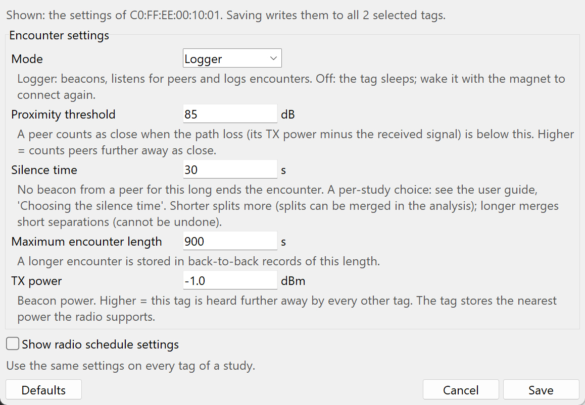

# Tag Settings

Select one or more tags and press **Settings...**. With several tags selected,
the dialog shows the first tag's settings and **Save writes them to every
selected tag**, which is the easy way to give a whole study identical settings.
Only changed values are written; the log shows what each tag accepted (the tag
may round, e.g. the TX power to a step its radio supports).

*The settings dialog, two tags selected.*

| Setting | Default | Range | What it does |
|---|---|---|---|
| Mode | Logger | Logger, Off | Off: the tag sleeps and stops logging; wake it with the magnet. |
| Proximity threshold | 85 dB | 0–200 dB | A peer is close when the path loss (its TX power minus the received signal) is below this. Higher counts peers further away as close. |
| Silence time | 30 s | 2–65,535 s | No beacon from a peer for this long ends the encounter. **A per-study choice**, see below. |
| Maximum encounter length | 900 s | 1–65,535 s | A longer encounter is stored as back-to-back records of this length. |
| TX power | −1.0 dBm | −50.0 to +6.0 dBm | Beacon power. Higher: this tag is heard further away by every other tag. |
| *Radio schedule* (tick "Show radio schedule settings") | | | |
| Beacon interval | 100 ms | 100–40,000 ms | Time between beacons. |
| Beacon duration | 1 (×100 ms) | 0–100 | Advert burst per beacon; at least the interval = advertise continuously (default). |
| Scan interval / window | 1,000 / 35 ms | | The tag listens for *window* ms of every *interval* ms. |
| RSSI split | 0 (off) | 0–60 dB | A signal change of more than this starts a new record. |

**Use the same settings on every tag of a study**, so encounters are seen the
same way from both sides.

The radio schedule decides battery life and how quickly a tag notices its
neighbours. Listening costs the most battery, so the defaults send often and
listen little. Change them only for a reason, and measure battery life before
deploying other values.

## Choosing the silence time

A tag does not hear a close peer continuously: with the default settings about
0.3 times a second (bench, line of sight), less on animals (body shading) and in
dense groups. So two kinds of error are possible:

- **False split:** the tag misses every beacon from a peer for longer than the
  silence time although the animals stayed together, and one encounter is stored
  as two.
- **False merge:** the animals really separate, but for less than the silence time
  plus a few seconds of detection delay, and two encounters are stored as one.

Expected false splits during continuous contact between two tags:

| Silence time | Peer heard 0.3 times/s (bench) | 0.15 times/s (heavy shading) |
|---|---|---|
| 15 s | about 13 per hour | about 57 per hour |
| 20 s | about 3 per hour | about 27 per hour |
| 30 s (default) | 1 per about 6 hours | about 6 per hour |
| 45 s | 1 per about 19 days | 1 per about 1.6 hours |
| 60 s | negligible | 1 per about 15 hours |
| 90 s | negligible | 1 per about 8 weeks |

- **Splits can be joined during the analysis, merges cannot be undone.** Two
  records of the same pair that are closer together than your bout criterion can
  be merged afterwards. When unsure, choose the shorter silence time.
- Animals that rest in contact for long periods (shared roosts, dens, nests): 60
  to 120 s avoids splits and loses nothing the question needs.
- Brief, frequent contacts (groups that split and rejoin while foraging): 15 to
  30 s, and merge in the analysis.
- Large animals, or tags often on the far side of the body: use the
  heavy-shading column.
- Each encounter edge is late by a detection delay, on average about 3 s at the
  start and 3 s at the end with the default settings.
- A pilot helps: two tags on animals or animal models together for an hour, then
  count the splits.
